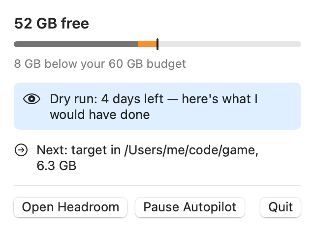

# Design review, round 0: Headroom

Blind review of the round-0 renders only. No source code was read. Every screenshot in `round-0/` was opened: all five menu states and all four window panes in light and dark, the contrast variants, and the menu-bar icon in all 20 combinations. Colors were sampled from the PNGs and contrast was computed with the WCAG formula.

## Scores

Strict scale: 9+ means Apple could ship it as is, 7 means solid with polish left, 5 means it works but a reviewer would send it back, 3 or below means broken for some people.

| Screen | Score | One-line reason |
| --- | :-: | --- |
| Menu: first run ([light](round-0/menu-first-run-light.png), [dark](round-0/menu-first-run-dark.png)) | 4.5/10 | Honest, plain copy and a good Full Disk Access ask, but three stacked asks fight for attention and a dry-run countdown runs before any budget exists |
| Menu: dry run ([light](round-0/menu-dry-run-light.png), [dark](round-0/menu-dry-run-dark.png)) | 6/10 | "52 GB free" reads in a second, but "Next: target in …" says Headroom will act while the banner says it won't |
| Menu: plenty ([light](round-0/menu-plenty-light.png), [dark](round-0/menu-plenty-dark.png)) | 7.5/10 | The calmest, clearest state. The bar has no scale, and the status line repeats the caption |
| Menu: acting ([light](round-0/menu-acting-light.png), [dark](round-0/menu-acting-dark.png)) | 5/10 | Looks almost the same as dry run: no "deleting now", no "when", and the 3 GB shortfall is a 5 px orange sliver |
| Menu: error ([light](round-0/menu-error-light.png), [dark](round-0/menu-error-dark.png)) | 2.5/10 | Orange body text at 2.31:1 on white, the free-space number disappears, there's no recovery button, and the copy says "core" |
| Menu-bar icon ([all 20 combined](#menu-bar-icon)) | 4/10 | A clean template symbol, but five states render as two glyphs, so error, first run and plenty look the same |
| History ([light](round-0/window-history-plenty-light.png), [dark](round-0/window-history-plenty-dark.png)) | 5.5/10 | A clean, readable list, but "Undo" is really a rebuild, there's no total or column headers, and the trailing margin is cramped |
| Would Have Done ([light](round-0/window-would-have-done-plenty-light.png), [dark](round-0/window-would-have-done-plenty-dark.png)) | 5/10 | A total is a good idea, but the header is faint, "Dry run is over" leads nowhere, and no row can be excluded |
| Settings ([light](round-0/window-settings-plenty-light.png), [dark](round-0/window-settings-plenty-dark.png)) | 5/10 | The grouped form is the right look in the wrong container (a sidebar pane, not a Settings window). It has a detached stepper and no Full Disk Access status |
| Empty states ([History](round-0/window-history-first-run-light.png), [Would Have Done](round-0/window-would-have-done-first-run-light.png)) | 6.5/10 | They look like ContentUnavailableView with good copy, but neither has a button for the next step |
| First run, end to end (menu + [Settings](round-0/window-settings-first-run-light.png) + empty panes) | 4/10 | The menu says no budget is set while Settings shows 60 GB, and the dry run counts down before setup |
| Dark and Increase Contrast, cross-cutting | 4.5/10 | Dark mode is mostly sound, but sidebar icons drop to 1.16:1 and Increase Contrast changes zero pixels anywhere |

**Findings: Critical 1 · High 10 · Medium 13 · Low 7**

**5-second test** ([menu-dry-run-light.png](round-0/menu-dry-run-light.png)): **Half pass.** How much is free: yes, instantly ("52 GB free", bold, top left). Whether Headroom will act: no. The caption says you're 8 GB under budget, and "Next: target in /Users/me/code/game, 6.3 GB" reads like an imminent deletion. The blue banner says it's only a dry run, and nothing says when anything happens. A reader can't tell in five seconds whether files will disappear, and the 6.3 GB candidate wouldn't even close the 8 GB gap.

---

## Design review: Headroom (macOS menu-bar utility + main window)

### Summary

**Overall rating: Critical issues** (one Critical contrast failure, ten High findings).

The thesis is right and rare: a fuel gauge for your disk. One number, one bar with a budget tick, and a single line saying what happens next. The design is built almost entirely from system type, system controls and SF Symbols, and it's quiet in the way a good utility should be. What will make it memorable is the **budget tick on the free-space bar**. That's the signature, and it's worth protecting.

What keeps it from feeling Apple-made is not the visuals. It's state and language. The five states don't read as five different situations. The question the product exists to answer ("will Headroom delete something, and when?") is never stated outright. Several screens contradict each other on first run. And the controls borrow dialog and sidebar patterns where macOS expects menu commands and a Settings window.

Context: macOS 13+, rendered offscreen at 2x. It looks like SwiftUI (Form with grouped style, List, NavigationSplitView-style sidebar, ContentUnavailableView-style empty states), but that's inferred from the pixels, not from code. The known render limits (no title bar, toolbar, traffic lights or menu material) are not counted as findings. Where a finding could be a render artifact, it says so.

### Critical

**C1. Error text is orange on white at 2.31:1**
- **What**: In [menu-error-light](round-0/menu-error-light.png), "Headroom's core gave no reply. Quit and reopen Headroom." is #FF8D28 on #FFFFFF at body size (about 13 pt): **2.31:1**, against the 4.5:1 required. Dark mode passes at 7.47:1 (#FF9230 on #1E1E1E), so this fails in light mode only. Increase Contrast doesn't fix it, because [menu-error-light-contrast](round-0/menu-error-light-contrast.png) is pixel-identical. This is the one message that must be read.
- **Why**: `accessibility.md › Vision`: "Strive to meet color contrast minimum standards … enough contrast between foreground text and icons and background colors." `color.md › Best practices`: "Make sure all your app's colors work well in light, dark, and increased contrast contexts."
- **Fix**: Set the message in `.primary` (labelColor) and let only the `exclamationmark.triangle.fill` symbol carry `.orange` (or `.yellow` with the multicolor rendering). Color then marks the state while the text stays legible. If the whole line must be tinted, use `Color(nsColor: .systemOrange)` only on the glyph, never on 13 pt text.

### Improvements

**H1. "Will Headroom act?" is never answered in plain words (High)**
- **What**: Dry run and acting share the same "Next: target in /Users/me/code/…, 6.3 GB" line. In dry run it means "would delete". In acting it means "will delete", but with no time, no progress and no "Deleting…". The only thing that tells them apart is the blue banner. Compare [dry run](round-0/menu-dry-run-light.png) with [acting](round-0/menu-acting-light.png). This is the design goal's second half, and it fails.
- **Why**: `feedback.md › Best practices`: "Consider integrating status feedback into your interface … people get important information without having to take action." `writing.md › Best practices`: "Consider each screen's purpose … put the most important information first." `charting-data.md › Aid comprehension`: a headline "that summarizes the information people need right now", as in the Weather example.
- **Fix**: Add one sentence under the number that is always a verdict, written per state:
  - Plenty: "Nothing to do. 52 GB above budget."
  - Acting: "Freeing 4.8 GB now…" with a determinate `ProgressView`, or "Will free 4.8 GB in 10 minutes."
  - Dry run: "Dry run: would free 6.3 GB today. Nothing is deleted until Nov 24."
  - First run: "Set a budget to start."

  Then demote "Next" to a detail row: "game · Rust build output · 6.3 GB".

**H2. The menu-bar icon has two looks for five states (High)**
- **What**: The [icon montage](#menu-bar-icon) shows first run, plenty and error with an upright needle, and dry run and acting with the needle tilted left. They're identical within each group in every appearance. An error, the state that most needs attention, can't be seen from the menu bar, and you can't tell dry run from acting.
- **Why**: `the-menu-bar.md › Menu bar extras`: "Consider using a symbol to represent your menu bar extra … the system can apply other colors to the black areas." `feedback.md`: "The current status of something" is the first thing feedback communicates. `accessibility.md › Vision`: "Convey information with more than color alone."
- **Fix**: Keep the template gauge, but give each state a shape change, not just a color: a needle position for the level, an SF Symbols badge (`exclamationmark`) for error, a dashed or hollow needle for dry run, and an animated or filled needle (honoring Reduce Motion) while it's deleting. Also give each state its own accessibility label: "Headroom: 52 GB free, dry run."

**H3. The error state gives up instead of helping (High)**
- **What**: [menu-error](round-0/menu-error-light.png) drops the free-space number and the bar. macOS can report free space even when the helper is down. The fix is "Quit and reopen Headroom", but there's no button that does it, and "Pause Autopilot" stays enabled although nothing is running. "Core" names the architecture, not something the user controls.
- **Why**: `writing.md › Best practices`: "Write clear error messages … be clear about what someone can do to fix it." `feedback.md › Best practices`: "Show people when a command can't be carried out and help them understand why." `menus.md › Labels`: "Show people when a menu item is unavailable."
- **Fix**: Keep "52 GB free" and the bar, which you can read from `volumeAvailableCapacityForImportantUsage`. Replace the copy with "Headroom stopped responding. Autopilot is paused until it restarts." and add a **Restart Headroom** button. Dim **Pause Autopilot** while the helper is down.

**H4. First run contradicts itself across screens (High)**
- **What**:
  1. [menu-first-run](round-0/menu-first-run-light.png) says "Choose how much space to keep free … won't delete anything until you do", but [Settings in first run](round-0/window-settings-first-run-light.png) already shows **Keep at least 60 GB free**.
  2. The same menu shows "Dry run: 7 days left — here's what I would have done" before there's a budget to have done anything against.
  3. In plenty, [Would Have Done](round-0/window-would-have-done-plenty-light.png) says "Dry run is over", while [Settings](round-0/window-settings-plenty-light.png) shows the Dry run switch on.

  Some of this may be sample data, but each one teaches the user not to trust the screen.
- **Why**: `design-principles.md › Familiarity`: "Keep visuals and interactions consistent." `design-principles.md › Responsibility`: "Be fully transparent about what your product does and why." `onboarding.md › Additional requests`: "Postpone nonessential setup flows … Provide reasonable default settings."
- **Fix**: Choose one model. Either suggest a default (show "60 GB" as a suggested budget in the menu with **Use 60 GB** and **Change…**) or show the Settings field empty until it's set. Start the 7-day countdown at the moment a budget exists, and hide the dry-run banner until then. Tie the Settings switch to the actual mode.

**H5. "Undo" is a rebuild, not an undo (High)**
- **What**: In [History](round-0/window-history-plenty-light.png), each row has an **Undo** button, and the empty state explains "with Undo to rebuild it." Clicking it re-runs `npm ci` / `cargo build`, which takes minutes, can need the network, and isn't exact. A model ("llama3.2") would need a re-download. On a Mac, "Undo" means Edit › Undo, ⌘Z, instant and exact. "Undone" in gray also breaks the trailing alignment.
- **Why**: `undo-and-redo.md › Best practices`: "Help people predict the results of undo and redo as much as possible." `undo-and-redo.md › Desktop (macOS)`: "Place undo and redo commands in the Edit menu and support the standard keyboard shortcuts." `writing.md › Best practices`: "Be action oriented … it's almost always best to use a verb."
- **Fix**: Label the button by what it does: **Rebuild…** (or **Re-download…** for models). The ellipsis signals a confirmation step: "Rebuild shop? Runs npm ci in /Users/me/code/shop. About 2 min, needs internet." While it runs, show a determinate or indeterminate progress row, then "Rebuilt" (keeping the verb, as in Publish → Published). Keep column widths fixed so the trailing edge stays aligned.

**H6. No agency: nothing can be protected or excluded (High)**
- **What**: Would Have Done is read-only. After "Dry run is over" it offers no next step: no **Keep Dry Run On**, no **Never Delete**, no per-row exclusion. Settings has no "never touch these folders" list. For an app that deletes things automatically, the user has no veto.
- **Why**: `design-principles.md › Agency`: "Let people do things their own way … Help people recover from mistakes." `settings.md › Task-specific options`: "Prefer letting people modify task-specific options without going to your settings area."
- **Fix**: Add a context menu and a trailing button on each Would Have Done and History row: **Never Delete "game"**, **Show in Finder**. Under the header, add a sentence and button: "Autopilot is now on. **Keep Dry Run On**". Add an "Excluded folders" list (a `Table` with +/−) to Settings.

**H7. Settings is a sidebar pane, not a Settings window (High)**
- **What**: Settings is the third sidebar item in the main window, next to two content views ([window-settings](round-0/window-settings-plenty-light.png)). It holds the most important control in the product (the budget), and the popover has no "Settings…" command.
- **Why**: `settings.md › Desktop (macOS)`: "When people choose the Settings item in your app's or game's App menu, your custom settings window opens." Also: "Make settings available in ways people expect … Command-Comma." `sidebars.md › Best practices` presents a sidebar as navigation among content areas.
- **Fix**: Move it into a SwiftUI `Settings { }` scene titled "Headroom Settings" (General, Exclusions), opened with ⌘, and a **Settings…** item in the popover. That leaves the main window with History and Would Have Done, which can then be a segmented control or a two-item sidebar. Put the budget itself in the popover too (see H1/H4) so people rarely need Settings.

**H8. The popover looks like a dialog, not a menu-bar extra (High)**
- **What**: Every menu state ends with a row of three bordered push buttons: Open Headroom · Pause Autopilot · Quit. These are commands, laid out like an alert's button row. "Pause Autopilot" doesn't show whether it's paused. "Quit" lacks the app name. There's no Settings… item.
- **Why**: `the-menu-bar.md › Menu bar extras`: "Display a menu — not a popover — when people click your menu bar extra. Unless the app functionality you want to expose is too complex for a menu." `menus.md › Toggled items`: "Consider using a changeable label that describes an item's current state." `menus.md › Labels`: "Append an ellipsis … when the action requires more information."
- **Fix**: The gauge justifies a custom header, so use `MenuBarExtra(.window)` for the header only, or a real `NSMenu` with a custom view item for the header and standard menu items below. Example menu: **Open Headroom** · **Pause Autopilot for 1 Hour / Until Tomorrow** (a submenu that becomes **Resume Autopilot** when paused) · separator · **Settings…** ⌘, · **Quit Headroom** ⌘Q. Menu items get keyboard navigation, hover highlight and accessibility for free.

**H9. Sidebar icons ignore the accent color and vanish in dark mode (High)**
- **What**: The sidebar symbols sample as #A8A8A8 on #F0F0F0 in light (2.09:1) and **#1C1C1C on #282828 in dark (1.16:1)**, so they're effectively invisible in [window-history-plenty-dark](round-0/window-history-plenty-dark.png). The dark icon is darker than its background, which suggests a non-template image or a hard-coded color. Unselected labels sample at #717171 on #F0F0F0 (4.28:1). That could be the offscreen window rendering as inactive, so check it on a device.
- **Why**: `sidebars.md › Best practices`: "By default, sidebar icons use your app's accent color … make sure your sidebar icons display the color people choose." `dark-mode.md › Icons and images`: "Use SF Symbols wherever possible. Symbols work well in both appearance modes when you use dynamic colors." `color.md › App accent colors`.
- **Fix**: Use `Label("History", systemImage: "clock.arrow.circlepath")` inside `List(selection:)` with `.listStyle(.sidebar)`, with no `.foregroundStyle` override, so the system tints icons with the accent color and selects them correctly in both appearances.

**H10. Increase Contrast changes nothing (High, verify on device)**
- **What**: All 32 `*-contrast.png` renders are pixel-identical to their standard twins. The only differing pixels are the live "N seconds ago" timestamps. Button borders, separators, secondary text, the bar track and the error orange are all unchanged. Either the renderer isn't applying the setting, or the colors are hard-coded rather than semantic.
- **Why**: `accessibility.md › Vision`: "Prefer system-defined colors. These colors have their own accessible variants that automatically adapt when people … enabl[e] Increase Contrast." `color.md › Best practices`: custom colors need "an increased contrast option for each variant." `dark-mode.md › Best practices`: test "in Dark Mode with Increase Contrast and Reduce Transparency turned on."
- **Fix**: First confirm that the render sets `NSWorkspace.accessibilityDisplayShouldIncreaseContrast` and the `.accessibilityHighContrast` appearance. If it does, replace every custom color (banner fill #E0EFFF and #1A2939, bar gray, secondary #808080) with an asset-catalog color that has High Contrast variants, or with system colors (`.secondary`, `.quaternary`, `Color(nsColor: .separatorColor)`).

**M1. Secondary text sits at 3.95:1 (Medium, estimate)**
- **What**: The captions ("8 GB below your 60 GB budget"), the Time Machine note, "Nothing planned…", the History paths and the Would Have Done header are all #808080 on #FFFFFF: **3.95:1**, below 4.5:1 at 11–13 pt. Dark mode passes at 5.92:1. On the real menu material, vibrancy may raise this, so it's an estimate.
- **Why**: `accessibility.md › Vision`, contrast minimums. `dark-mode.md › Text`: "Use the system-provided label colors for labels."
- **Fix**: Use `.secondary` (secondaryLabelColor) on the material, and confirm that it reaches 4.5:1 in Accessibility Inspector. Keep the Would Have Done header in `.primary` (see M7).

**M2. The orange shortfall segment fails non-text contrast and nearly disappears (Medium)**
- **What**: #FF8D28 against the #FFFFFF / #E8E8E8 track is 2.31:1, below the 3:1 for graphics. In acting, the 3 GB shortfall is about 5 px wide at 2x.
- **Why**: `color.md › Inclusive color`: "Avoid using colors that make it hard to perceive content." `charting-data.md › Best practices`: "Use a chart when you want to highlight important information."
- **Fix**: Draw the shortfall as a hatched or outlined region with a minimum width (say 6 pt), and label the tick "60 GB". The caption already states the number in text, so the bar doesn't rely on color alone. Keep it that way.

**M3. The bar has no stated scale (Medium)**
- **What**: What does the full width mean: disk capacity, or something else? In plenty, the blue fill stops about 40 px before the end. Nothing labels the ends or the tick.
- **Why**: `charting-data.md › Aid comprehension`: "Descriptive text titles, subtitles, and annotations help emphasize the most important information." `charting-data.md › Best practices`: "Make every chart in your app accessible."
- **Fix**: Add tiny end labels ("0" … "494 GB disk"), or caption the bar "52 of 494 GB free". Give the bar an accessibility value: "52 gigabytes free, budget 60, 8 below."

**M4. Blue means two things (Medium)**
- **What**: Blue is the "above budget" bar fill in plenty, and also the dry-run banner fill. Orange means both "shortfall" and "error".
- **Why**: `color.md › Best practices`: "Avoid using the same color to mean different things."
- **Fix**: Make the surplus fill green (`.green`, healthy) or the accent color, and make the dry-run banner neutral (`.quaternary` fill with an `eye` glyph). Keep orange for "needs attention" and use a symbol, not text color, for errors (see C1).

**M5. "Pause Autopilot" shows no state, and "Autopilot" appears nowhere else (Medium)**
- **What**: No screen says Autopilot is on. Settings calls the mode "Dry run", and the menu calls it "Autopilot".
- **Why**: `menus.md › Toggled items`: "Consider using a changeable label that describes an item's current state." `writing.md › Best practices`: "Build language patterns."
- **Fix**: Name the mode once and use that name everywhere, for example "Autopilot: On / Dry run / Paused" as a status line in the menu, with the item switching between **Pause Autopilot** and **Resume Autopilot**.

**M6. The empty states have no next step (Medium)**
- **What**: "Nothing deleted yet" and "Nothing to report yet" are well written, but there's no button. In first run, the next step is setting a budget.
- **Why**: `writing.md › Best practices`: "Provide clear next steps on any blank screens … give them a button or link to do so if possible."
- **Fix**: Use `ContentUnavailableView { … } actions: { Button("Set Budget…") }` in first run. On History during dry run, add **Show Would Have Done**.

**M7. The Would Have Done summary is the weakest text on the screen (Medium)**
- **What**: "Would have freed 8.9 GB. Dry run is over." is small, bold and gray (#808080, 3.95:1), pinned above a hairline that runs full width while the list is inset.
- **Why**: `layout.md › Visual hierarchy`: "Order content by relative importance." `charting-data.md › Aid comprehension`: a "headline or summary … helping people grasp essential information at a glance."
- **Fix**: Use `.title3` in primary for "Would have freed 8.9 GB", with a secondary subtitle "3 items · dry run ended Nov 18" and the H6 button. Inset the divider to the list margins, or drop it.

**M8. History has no total, column headers or sort (Medium)**
- **What**: Four rows with size and date aligned to the right, but no total freed, no headers and no way to sort by size or date.
- **Why**: `lists-and-tables.md › Desktop (macOS)`: "When it provides value, let people click a column heading to sort a table view." `lists-and-tables.md › Content`: "If you don't include a column heading in a single-column table view, use a label or a header."
- **Fix**: Add a header line, "Freed 9 GB in the last 7 days", and either a SwiftUI `Table` with Name / Kind / Size / Deleted columns (sortable) or a sort menu.

**M9. Names come from the file system, not from the user's world (Medium)**
- **What**: "Atlas-bxjqk" is a raw DerivedData hash folder, and "target" is Cargo's folder name used as a noun ("Next: target in …"). "node_modules · /Users/me/code/shop" repeats the project name that's already in the title.
- **Why**: `writing.md › Getting started`: "Write for everyone … avoiding jargon."
- **Fix**: Title is the project, subtitle is the kind in plain words: "Atlas — Xcode build data", "engine — Rust build output", "shop — npm packages". Show the path on hover or in a Show in Finder action, abbreviated with `~`.

**M10. A model download is presented as "rebuildable" (Medium)**
- **What**: "llama3.2 · model · /Users/me/.ollama/models" (2 GB) sits next to build output. Undo for it is a 2 GB download, not a rebuild.
- **Why**: `design-principles.md › Responsibility`: "Be fully transparent about what your product does and why."
- **Fix**: Group or flag items by how they come back (rebuild or re-download) and show that in the row, for example "Re-download, 2 GB".

**M11. The "Leave projects alone" stepper is detached from its value (Medium)**
- **What**: The value "14 days" is inside the label, and a bare stepper sits about 280 pt away at the far trailing edge.
- **Why**: `layout.md › Visual hierarchy`: "Align elements to make them easier to scan." `writing.md › Best practices`: "Keep settings labels clear and simple."
- **Fix**: Use `Picker("Leave recently opened projects alone for", selection:) { 7, 14, 30, 90 days }` as a pop-up button, or `LabeledContent` with "14 days" and the stepper side by side, the way "60 GB free" is laid out.

**M12. Full Disk Access shows no status, and the button names differ (Medium)**
- **What**: In first run, Settings shows "Full Disk Access [Open Privacy Settings]" with no sign that access is missing, while the menu says "Headroom can't read some folders" and its button reads "Open Full Disk Access Settings".
- **Why**: `writing.md › Best practices`: "Give clear guidance and use consistent language throughout processes with multiple steps." `feedback.md`: "The current status of something."
- **Fix**: Show the state: "Full Disk Access: Not allowed" with an `exclamationmark.triangle` glyph, or "Allowed" with a checkmark. Use one button label in both places: **Open Full Disk Access Settings…**.

**M13. "Launch at login" is off in both sample states (Medium)**
- **What**: An autopilot that protects free space does nothing if it isn't running.
- **Why**: `settings.md › Best practices`: "Aim to provide default settings that give the best experience to the largest number of people."
- **Fix**: Turn it on during setup with an explicit, visible switch in the first-run menu, using `SMAppService.mainApp.register()`, and leave it changeable in Settings.

**L1. Uneven window margins (Low)**: In History, the Undo buttons sit 8 pt from the window's trailing edge, while content starts 17 pt from the sidebar divider. The "2.1 GB" column shifts 2 pt in the Undone row. `layout.md › Visual hierarchy` ("Align elements to make them easier to scan"). Use 20 pt trailing padding and a fixed-width accessory column.

**L2. The voice changes person (Low)**: The banner says "here's what **I** would have done", and everything else says "Headroom won't delete…". `writing.md › Best practices` ("Build language patterns"). Use "Dry run: 4 days left. See what Headroom would have deleted." and make the banner itself a link to Would Have Done.

**L3. Paths are spelled in full (Low)**: Show `~/code/shop` instead of `/Users/me/code/shop`, and use middle truncation for long paths. `lists-and-tables.md › Content` ("an ellipsis in the middle of text can make an item easier to distinguish").

**L4. Every row has the same generic folder icon (Low)**: It takes 26 pt per row and says nothing. Use kind icons (npm, Xcode, Rust, Python venv, model), drawn as SF Symbols or custom symbols. `sidebars.md › Best practices` ("Consider using familiar symbols") and `menus.md › Icons` ("Use menu item icons sparingly and with purpose").

**L5. Redundant status line in plenty (Low)**: "52 GB above your 60 GB budget" is followed by "Nothing planned. You're above budget." One sentence is enough: "Nothing to do. 52 GB above budget." `design-principles.md › Simplicity` ("Be concise").

**L6. First-run button alignment (Low)**: "Open Full Disk Access Settings" aligns to the popover margin (x = 14 pt), while its explanation is indented past the lock glyph (x = 36 pt). Align the button to the text it belongs to. `layout.md › Visual hierarchy` ("indented items as subordinate to the item they follow").

**L7. The empty-state pane has no background (Low, may be render-only)**: In first run, the detail pane is fully transparent (alpha 0), while the populated list has an opaque #FFFFFF / #1E1E1E background. In a real window, the pane background would jump when the first item arrives. Give both states the same `.background`. `windows.md › Desktop (macOS)` ("Make sure custom windows use the system-defined appearances").

### Craft notes

- **Point of view (keep it):** The free-space bar with a budget tick is a real idea, and it's specific to this product. Make it the hero: give it a larger numeral (the headline is about 17 pt; a 26–28 pt `.rounded` monospaced-digit number would win the 5-second test on its own), a labeled tick and a calm color system. Everything else in the popover should get quieter around it. Judgment, supported by `design-principles.md › Delight` ("Create defining moments").
- **Icon and bar don't share a metaphor (Medium):** The menu-bar icon is a round speedometer, while the popover is a linear bar with a tick. Either draw a tiny bar-with-tick template icon whose fill shows the level, or make the popover's hero a gauge. One metaphor in both places is what makes it memorable. `design-principles.md › Familiarity` ("Keep visuals and interactions consistent").
- **Not a template:** No cream-and-serif, no acid accent, no fake broadsheet. It's honest system UI. Restraint is the right call for a utility, so don't add a brand color. Spend the one bold move on the bar.
- **Remove one accessory:** The dry-run banner box. Stated as a verdict line (H1) with an `eye` glyph, it needs no colored container, which also fixes M4.

### What works

- **Free space reads in one second.** The bold number sits first, top left, in every non-error state. Keep that order.
- **The copy is plain and human.** "Choose how much space to keep free. Headroom won't delete anything until you do." and "A local Time Machine snapshot is holding some freed space until macOS removes it." are both excellent. The Time Machine note explains a real macOS confusion before anyone asks.
- **The Full Disk Access ask is in context and honest.** It explains the benefit ("to measure them") and goes straight to the right pane (`onboarding.md › Additional requests`: permission requested "when people first access the specific function").
- **Settings uses the grouped Form look of System Settings.** Sections, row dividers and a trailing control column are correct. The look should stay when it moves into a Settings window.
- **The empty states look like ContentUnavailableView**, with a symbol, a title and a one-line explanation.
- **Dark mode is mostly right.** Text contrast passes (primary about 13:1, secondary 5.92:1, orange 7.47:1), and controls and dividers adapt. The exception is the sidebar icons (H9).
- **The 7-day dry run as a product decision** is the strongest trust pattern here. It needs a clearer exit (H6), not a redesign.

### Platform notes

- **macOS 13 floor:** `ContentUnavailableView` is macOS 14+, so on 13 keep the hand-built equivalent you appear to have. `MenuBarExtra(.window)` and the `Settings` scene are both macOS 13. `SMAppService` (launch at login) is macOS 13. Nothing above needs a newer OS.
- **Liquid Glass:** Not applicable to a macOS 13 deployment target beyond what the system applies to standard controls. Don't fake it in the popover.
- **Keyboard:** It can't be verified from the renders. Check that the popover is fully keyboard-reachable (Tab through controls, Esc closes it), that ⌘, opens Settings and that ⌘Q works. A real `NSMenu` (H8) solves most of this for free.
- **VoiceOver:** It can't be verified from the renders. The bar needs an accessibility value (M3), and the menu-bar item needs a label that changes with state (H2).
- **Render limits observed, not counted:** the window renders as inactive (gray sidebar selection, gray switches), and there's no menu vibrancy. Recheck M1 and the sidebar label contrast in H9 on a live, key window.

### Menu-bar icon

Columns: first run · dry run · plenty · acting · error. Rows: light · dark · light + Increase Contrast · dark + Increase Contrast. Composited from the 20 `icon-*.png` files and enlarged 4x.

| | First run | Dry run | Plenty | Acting | Error |
| --- | --- | --- | --- | --- | --- |
| Light |  |  |  |  |  |
| Dark |  |  |  |  |  |

The needle is upright for first run, plenty and error, and tilted for dry run and acting. The contrast variants are identical to the standard ones.
